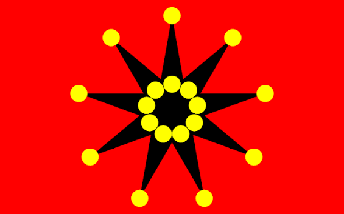
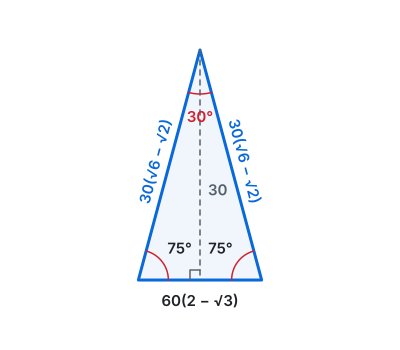
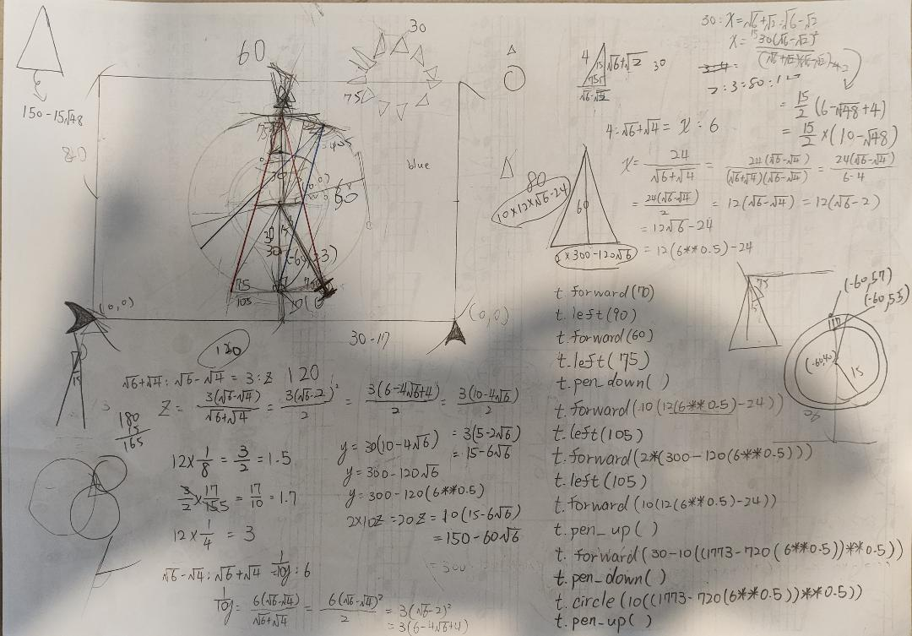
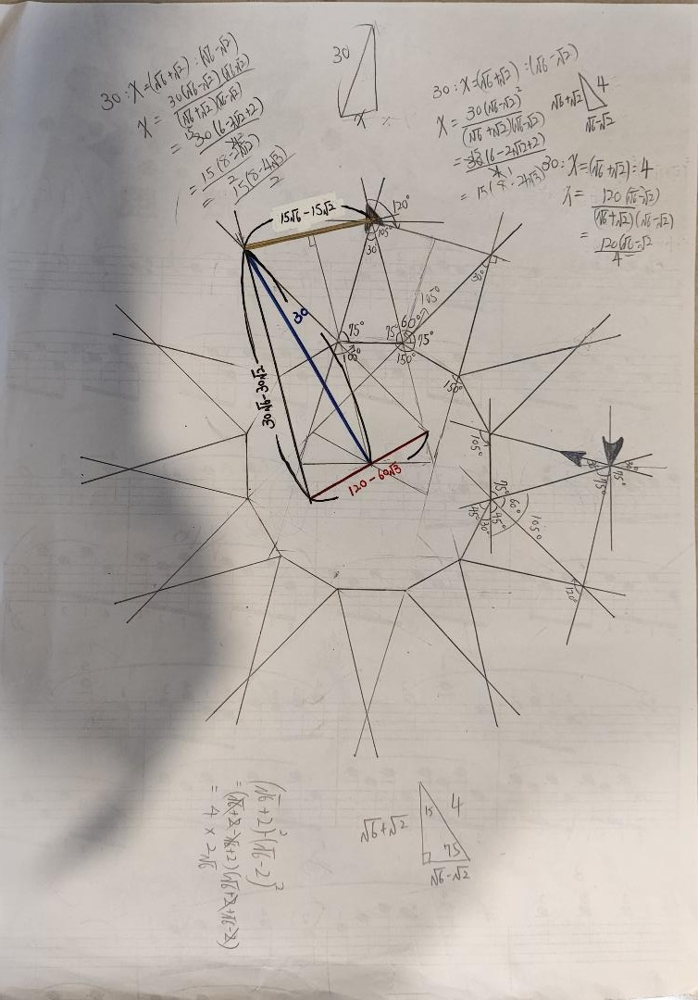

# 🇹🇼 ROC-flag

> [🇹🇼 正體中文](#-正體中文) ・ [🇺🇸/🇬🇧 English](#english)

<p align="center">
  
  
  
</p>

---

## 🇹🇼 正體中文

### 專案簡介

本專案以 Python 內建的 `turtle` 函式庫，用數學公式重現三面與中華民國密切相關的旗幟：

1. **中華民國國旗**（青天白日滿地紅）——依[**中華民國內政部**](https://ws.moi.gov.tw/Download.ashx?u=LzAwMS9VcGxvYWQvT2xkRmlsZS9jaXZpbF9sYXdfZmlsZS9kXzM4Nzc3XzQwNDU4MzMzMzMucGRm&n=ZF8zODc3N180MDQ1ODMzMzMzLnBkZg%3D%3D)**頒布之國旗畫法**繪製。
2. **鐵血十八星旗**——辛亥革命武昌起義旗幟，依據[**武昌首義同志會**](https://www.19111010.com.tw/story?id=96)**之歷史考證**繪製。
3. **五色旗**（五族共和旗）——中華民國建國初期（1912–1928）國旗，以 **8:5**（橫:縱）旗面繪製五色橫條。

專案提供多種解析度版本，以維持不同顯示環境下的比例與精確度。

### 快速開始

**需求**：Python 3（內含 `turtle`，部分 Linux 發行版需另外安裝 `python3-tk`）。

```bash
git clone https://github.com/091cc/ROC-flag.git
cd ROC-flag

python3 "ROC_flag(240x160).py"                      # 中華民國國旗
python3 "Iron-Blooded_18_stars_flag(240x150).py"    # 鐵血十八星旗
python3 "ROC_flag(1912-1928)(240x150).py"           # 五色旗
```

### 檔案一覽

| 旗幟 | 檔案名稱 | 解析度 | 比例 | 狀態 |
| --- | --- | --- | --- | --- |
| 中華民國國旗 | [`ROC_flag(240x160).py`](https://github.com/091cc/ROC-flag/blob/main/ROC_flag(240x160).py) | 240 × 160 | 1.0x（基準） | 可用 |
| 中華民國國旗 | [`ROC_flag(600x400).py`](https://github.com/091cc/ROC-flag/blob/main/ROC_flag(600x400).py) | 600 × 400 | 2.5x | 可用 |
| 鐵血十八星旗 | [`Iron-Blooded_18_stars_flag(240x150).py`](https://github.com/091cc/ROC-flag/blob/main/Iron-Blooded_18_stars_flag(240x150).py) | 240 × 150 | 1.0x（基準） | 可用 |
| 五色旗 | [`ROC_flag(1912-1928)(240x150).py`](https://github.com/091cc/ROC-flag/blob/main/ROC_flag(1912-1928)(240x150).py) | 240 × 150 | 1.0x（基準） | 可用 |

---

### 一、中華民國國旗

#### 繪製規範

- **旗面**：橫:縱 = 3:2 的紅色長方形。
- **青天**：左上角佔全旗 $1/4$ 的青色長方形（縱橫各為旗面之 $1/2$）。
- **白日位置**：以青天長方形之中心為白日圓心。
- **白日體**：半徑為青天高度之 $1/8$。
- **十二道光芒**：
  - 光芒頂點（外圓）半徑為白日體半徑之 $17/15$ 倍。
  - 每道光芒間隔 $30^\circ$，頂點位於外圓周上，基部與白日體相連。
  - 白日體與十二道光芒均為純白色。
- **配色**：青天 `#14337A`・白日 `#FFFFFF`・紅地 `#CC000E`

<details>
<summary>十二道光芒的幾何細節（以 240 × 160 為例）</summary>

<p align="center">
  
  <br>
  <sub>圖：青天左上角白日與十二道光芒的局部放大（240 × 160）</sub>
</p>

相鄰兩道光芒的夾角為 $30^\circ$，對應的等腰三角形頂角 $30^\circ$、底角各 $75^\circ$，三邊比為：

$$
\text{底} : \text{腰} : \text{腰} = (\sqrt{3}-1) : \sqrt{2} : \sqrt{2}
$$

代入 240 × 160 的實際尺寸：

| 項目 | 算式 | 數值 |
| --- | --- | --- |
| 青天高度 | $160 \times \frac{1}{2}$ | 80 |
| 白日體半徑 | $80 \times \frac{1}{8}$ | 10 |
| 外圓半徑（光芒頂點） | $10 \times \frac{17}{15}$ | ≈ 11.33 |
| 三角形底邊（若腰 = 外圓半徑） | $11.33 \times \frac{\sqrt{3}-1}{\sqrt{2}}$ | ≈ 5.87 |

</details>

---

### 二、鐵血十八星旗

#### 繪製規範

依據**武昌首義同志會**考證，以旗橫長 $L=20$ 單位為基準：

- **旗面**：橫:縱 = **8:5** 的正紅色長方形。
- **黑色九角星**：施萊夫利符號 **{9/4}**，每個尖角 $20^\circ$，置中於旗面。
- **外九星**：位於大圓（半徑 $R = \frac{11}{2}$ 單位）上，對應各尖頂。
- **內九星**：位於小圓（半徑 $r = \frac{3}{2}$ 單位）上，與外星同處一內角平分線方向。
- **十八顆黃星大小一致**。
- **配色**：正紅 `#FF0000`・正黑 `#000000`・正黃 `#FFFF00`

<details>
<summary>幾何公式</summary>

九角星突出三角形的精確邊長（$L=240$，縮放因子 $= 12$）：

**斜邊**（尖頂 → 內凹點）：

$$12 \times \sqrt{\frac{65 - 33\cos\dfrac{\pi}{9}}{2}} \approx 49.47$$

**底邊**（兩內凹點連線）：

$$36\sin\frac{\pi}{9} \approx 12.31$$

```python
import math

hypotenuse = 12 * math.sqrt((65 - 33 * math.cos(math.pi / 9)) / 2)
base = 36 * math.sin(math.pi / 9)
```

</details>

---

### 三、五色旗（五族共和旗）

#### 歷史背景

五色旗為中華民國第一代國旗，由南京臨時政府與北洋政府採用，使用期間為**民國元年（1912）至民國 17 年（1928）**。旗面由上而下依序為紅、黃、藍、白、黑五色橫條，分別象徵漢、滿、蒙、回、藏五族共和；五色同時呼應傳統五行（火、土、木、金、水）與五德（仁、義、禮、智、信）。1928 年北伐完成後，由青天白日滿地紅旗取代。

#### 繪製規範

- **旗面**：橫:縱 = **8:5**（本專案採用之比例）。
- **五色橫條**：由上而下均分五條，每條高度為旗面高度之 $1/5$。

| 橫條 | 顏色 | 色碼 | 象徵民族 |
| --- | --- | --- | --- |
| 第一條 | 紅 | `#FE0000` | 漢族 |
| 第二條 | 黃 | `#FFC000` | 滿族 |
| 第三條 | 藍 | `#0070C0` | 蒙古族 |
| 第四條 | 白 | `#FFFFFF` | 回族 |
| 第五條 | 黑 | `#000000` | 藏族 |

---

### 開發背景與致謝

<p align="center">
  
  <br>
  <sub>圖一：三角函數推導與餘弦定理計算紙</sub>
</p>

<p align="center">
  
  <br>
  <sub>圖二：12 道光芒放射狀幾何設計草圖</sub>
</p>

**中華民國國旗**之核心幾何計算法由 **[sugardaddy16](https://github.com/sugardaddy16)** 與**本人**共同研發完成。

開發過程中，我們投入了整整一天進行數學推導與座標校正。當時正值重要考試前九天的衝刺期，我們仍憑藉對程式開發、幾何美學與愛國的熱忱，完成了這項兼顧精確度與美觀的專案。特別感謝 Seven 在複雜三角形計算上的校正與貢獻。

**鐵血十八星旗**之規格考證參考自[武昌首義同志會](https://www.19111010.com.tw)。

### 授權

（請在此填入授權條款，例如 MIT License，並於儲存庫根目錄加入 `LICENSE` 檔。）

---

## 🇺🇸/🇬🇧English

### Overview

This project reproduces three flags closely associated with the Republic of China using Python's built-in `turtle` library and mathematical formulas:

1. **ROC National Flag** (Blue Sky, White Sun, and a Wholly Red Earth) — drawn following the flag construction specifications issued by the **[Ministry of the Interior, ROC](https://ws.moi.gov.tw/Download.ashx?u=LzAwMS9VcGxvYWQvT2xkRmlsZS9jaXZpbF9sYXdfZmlsZS9kXzM4Nzc3XzQwNDU4MzMzMzMucGRm&n=ZF8zODc3N180MDQ1ODMzMzMzLnBkZg%3D%3D)**.
2. **Iron-Blooded 18-Star Flag** (鐵血十八星旗) — the flag of the Hubei Military Government during the 1911 Wuchang Uprising, drawn according to historical research by the **[Wuchang Uprising Comrades Association](https://www.19111010.com.tw/story?id=96)**.
3. **Five-Color Flag** (五色旗, Five Races Under One Union) — the first national flag of the Republic of China (1912–1928), rendered with five equal horizontal stripes on an **8:5** field.

Multiple resolutions are provided so proportions stay accurate across different displays.

### Quick Start

**Requirements**: Python 3 (`turtle` is built in; some Linux distributions need `python3-tk` installed separately).

```bash
git clone https://github.com/091cc/ROC-flag.git
cd ROC-flag

python3 "ROC_flag(240x160).py"                      # ROC National Flag
python3 "Iron-Blooded_18_stars_flag(240x150).py"    # Iron-Blooded 18-Star Flag
python3 "ROC_flag(1912-1928)(240x150).py"           # Five-Color Flag
```

### Files

| Flag | Filename | Resolution | Scale | Status |
| --- | --- | --- | --- | --- |
| ROC National Flag | [`ROC_flag(240x160).py`](https://github.com/091cc/ROC-flag/blob/main/ROC_flag(240x160).py) | 240 × 160 | 1.0x (Base) | Available |
| ROC National Flag | [`ROC_flag(600x400).py`](https://github.com/091cc/ROC-flag/blob/main/ROC_flag(600x400).py) | 600 × 400 | 2.5x | Available |
| Iron-Blooded 18-Star Flag | [`Iron-Blooded_18_stars_flag(240x150).py`](https://github.com/091cc/ROC-flag/blob/main/Iron-Blooded_18_stars_flag(240x150).py) | 240 × 150 | 1.0x (Base) | Available |
| Five-Color Flag | [`ROC_flag(1912-1928)(240x150).py`](https://github.com/091cc/ROC-flag/blob/main/ROC_flag(1912-1928)(240x150).py) | 240 × 150 | 1.0x (Base) | Available |

---

### I. ROC National Flag

#### Drawing Specifications

- **Aspect ratio**: a red field with a 3:2 width-to-height ratio.
- **Blue canton**: a blue rectangle in the upper-left corner occupying 1/4 of the flag area.
- **Sun placement**: the center of the blue canton is the center of the white sun.
- **Sun body**: radius equal to 1/8 of the height of the blue canton.
- **Twelve rays**:
  - The outer radius (ray tips) is 17/15 times the radius of the sun body.
  - Rays are spaced at 30° intervals, with tips on the outer circle and bases joined to the sun body.
  - The sun body and all twelve rays are solid white.
- **Colors**: Blue `#14337A`・White `#FFFFFF`・Red `#CC000E`

<details>
<summary>Geometry of the twelve rays (example: 240 × 160)</summary>

<p align="center">
  
  <br>
  <sub>Figure: Close-up of the white sun and its twelve rays in the upper-left corner of the blue canton (240 × 160)</sub>
</p>

The angle between two adjacent rays is $30^\circ$, giving an isosceles triangle with a $30^\circ$ vertex angle and two $75^\circ$ base angles. Its side ratio is:

$$
\text{Base} : \text{Side} : \text{Side} = (\sqrt{3}-1) : \sqrt{2} : \sqrt{2}
$$

With the actual 240 × 160 dimensions:

| Item | Formula | Value |
| --- | --- | --- |
| Blue canton height | $160 \times \frac{1}{2}$ | 80 |
| Sun body radius | $80 \times \frac{1}{8}$ | 10 |
| Outer circle radius (ray tips) | $10 \times \frac{17}{15}$ | ≈ 11.33 |
| Triangle base (if side = outer radius) | $11.33 \times \frac{\sqrt{3}-1}{\sqrt{2}}$ | ≈ 5.87 |

</details>

---

### II. Iron-Blooded 18-Star Flag

#### Drawing Specifications

Based on research by the Wuchang Uprising Comrades Association, using flag width $L = 20$ units as the reference:

- **Aspect ratio**: red field, width-to-height = **8:5**.
- **Black 9-pointed star**: Schläfli symbol **{9/4}**, each point angle $20^\circ$, centered on the flag.
- **Outer 9 stars**: on the large circle ($R = \frac{11}{2}$ units), at each spike tip.
- **Inner 9 stars**: on the small circle ($r = \frac{3}{2}$ units), along each interior angle bisector.
- **All 18 yellow circles are equal in size.**
- **Colors**: Red `#FF0000` ・ Black `#000000` ・ Yellow `#FFFF00`

<details>
<summary>Geometry</summary>

Exact side lengths of each spike triangle ($L = 240$, scale factor $= 12$):

**Hypotenuse** (spike tip → concave point):

$$12 \times \sqrt{\frac{65 - 33\cos\dfrac{\pi}{9}}{2}} \approx 49.47$$

**Base** (between two adjacent concave points):

$$36\sin\frac{\pi}{9} \approx 12.31$$

```python
import math

hypotenuse = 12 * math.sqrt((65 - 33 * math.cos(math.pi / 9)) / 2)
base = 36 * math.sin(math.pi / 9)
```

</details>

---

### III. Five-Color Flag (Five Races Under One Union)

#### Historical Background

The Five-Color Flag was the first national flag of the Republic of China, used by both the Nanjing Provisional Government and the Beiyang Government from **1912 to 1928**. Its five horizontal stripes — red, yellow, blue, white, and black from top to bottom — represent the Han, Manchu, Mongol, Hui, and Tibetan peoples, embodying the idea of Five Races Under One Union (五族共和). The colors also echo the traditional Five Elements (fire, earth, wood, metal, water) and the Five Virtues (benevolence, righteousness, propriety, wisdom, faithfulness). It was replaced by the Blue Sky, White Sun, and a Wholly Red Earth flag after the Northern Expedition concluded in 1928.

#### Drawing Specifications

- **Aspect ratio**: **8:5** width-to-height (the ratio adopted by this project).
- **Five equal stripes**: five horizontal bands, each 1/5 of the flag height.

| Stripe | Color | Hex | People represented |
| --- | --- | --- | --- |
| 1st | Red | `#FE0000` | Han |
| 2nd | Yellow | `#FFC000` | Manchu |
| 3rd | Blue | `#0070C0` | Mongol |
| 4th | White | `#FFFFFF` | Hui |
| 5th | Black | `#000000` | Tibetan |

---

### Acknowledgments & Background

<p align="center">
  
  <br>
  <sub>Figure 1: Trigonometric derivation and law-of-cosines worksheet</sub>
</p>

<p align="center">
  
  <br>
  <sub>Figure 2: Geometric design sketch of the 12 radiating rays</sub>
</p>

The core geometric algorithms for the **ROC National Flag** were co-developed by **[sugardaddy16](https://github.com/sugardaddy16)** and **myself**.

We spent a whole day on mathematical derivation and coordinate correction. Although it was the critical sprint period, nine days before an important exam, we saw the project through with enthusiasm for programming, geometric aesthetics, and patriotism, aiming for both accuracy and beauty. Special thanks to Seven for his corrections and contributions to the complex trigonometric calculations.

The **Iron-Blooded 18-Star Flag** specifications are referenced from the [Wuchang Uprising Comrades Association](https://www.19111010.com.tw).

### License

(Fill in the license here, e.g. MIT License, and add a `LICENSE` file to the repository root.)
